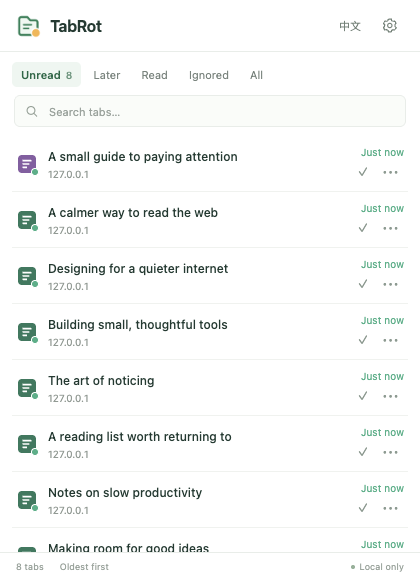
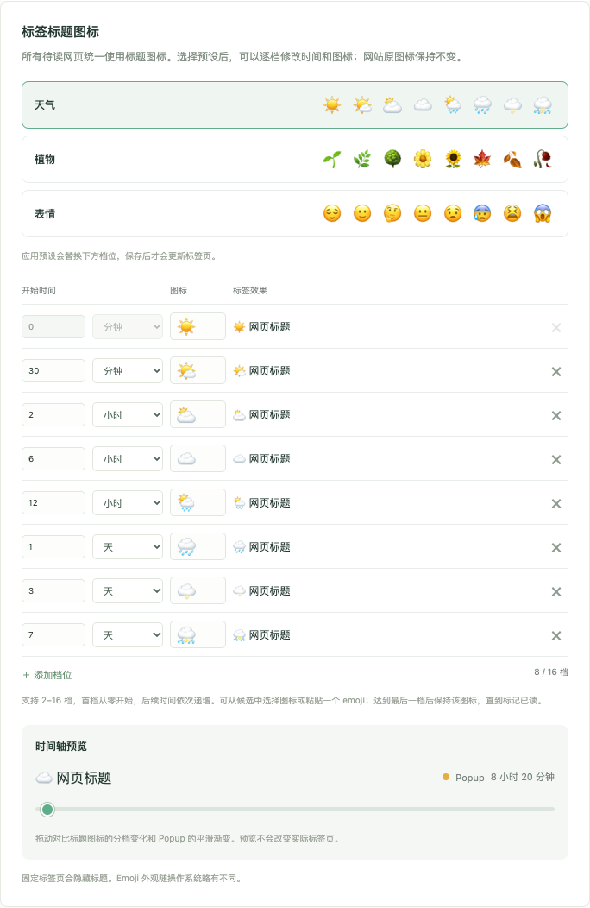

# TabRot

[简体中文](README.zh-CN.md)

A quiet reading reminder for Chrome. Tab titles show aging icons; the compact reading list shows a continuous green-to-red gradient. Website and bookmark favicons stay unchanged.

No accounts, notifications, analytics, AI, or cloud services. Plain JavaScript, HTML and CSS, using Manifest V3.



## Install

1. Download the source or unzip `dist/TabRot-v1.3.0.zip`.
2. Open `chrome://extensions` and enable **Developer mode**.
3. Choose **Load unpacked**, then select the directory containing `manifest.json`.
4. Pin TabRot in the Chrome toolbar.

Requires Chrome 120 or later. No build step or runtime dependencies.

## Use

- Normal HTTP/HTTPS pages are tracked automatically. Refreshing and switching tabs do not reset their timers.
- Every unread page receives a title icon, whether bookmarked or not. Website favicons are preserved. Browser-protected pages and some embedded viewers cannot receive title icons.
- The popup lists pages oldest first, with original titles, original icons, smooth age colors, search and status filters. Click a row to jump to its tab.
- Mark a tab as read to remove the title icon. Reading state is always manual.
- Snooze for an hour, until tomorrow at 9 AM, or for three days. Snoozing preserves the original timer.
- Ignore a tab or a website, including subdomains. Pinned tabs are ignored by default. Pinned tabs hide their titles, so title reminders are not visible even if pinned-tab exclusion is turned off.
- English is the default; switch to Chinese in the popup or settings. Language changes preserve unsaved settings drafts.

The 420 × 580 popup fits at least seven complete rows. Menus stay within the popup, including for the last row.

## Title icon stages

Choose **Weather**, **Plants**, or **Faces**, then customize the sequence. Color-circle and square presets are no longer included.

- Default: eight stages starting at zero, 30 minutes, 2 hours, 6 hours, 12 hours, 1 day, 3 days and 7 days.
- Add or remove stages (2–16), adjust start times in minutes/hours/days, and select or paste one emoji per stage.
- The first stage starts at zero. Later times must increase. The last stage remains until the page is marked read, snoozed or ignored.
- Applying a preset replaces the draft sequence; changes only take effect after **Save changes**.
- Drag the preview timeline to compare the stepped title icon and the continuous popup color without affecting real tabs.



## Popup colors and recovery

Popup colors are independent of title stages. The original eight gradient stops remain: 30 minutes, 2 hours, 6 hours, 12 hours, 1 day, 3 days, 7 days and 30 days. Colors interpolate continuously on a logarithmic time scale. Reminders refresh about once a minute; sleep and browser scheduling may delay updates.

Different paths or query parameters start a new timer; fragment-only navigation does not. Tabs open at installation begin counting when first discovered. Browser restarts match saved records to restored tabs by URL and position. Duplicate URLs are matched on a best-effort basis. Unmatched records are removed after a two-minute recovery window; closing an individual tab removes its record.

On upgrade, existing timers, reading states, ignore rules and popup color timing are preserved. Old fixed emoji presets migrate to eight stages; removed color presets use Weather. Legacy favicon markers in open pages are restored when possible without a page reload. A closed page's stale bookmark icon may still require opening that exact bookmark once so Chrome refreshes its cache.

## Privacy and permissions

Reading state, timers, settings and language preferences stay in local extension storage. Session storage holds current tab bindings. No data is uploaded. The extension does not access bookmarks or require the `bookmarks` permission.

| Permission | Purpose |
| --- | --- |
| `tabs` | Read open-tab titles, URLs and positions, and switch tabs. |
| `storage` | Save local settings and reading state. |
| `alarms` | Refresh reminders at low frequency. |
| `scripting` | Apply title markers to pages already open. |
| HTTP/HTTPS host access | Update page titles and restore legacy icon markers during upgrades. Legacy icon requests omit credentials and referrers. |

## Development

```sh
npm test
npm run check
python3 tools/package.py
```

Unit/lifecycle tests require Node.js 22 or later, with no additional packages. Optional real-browser tests use disposable profiles and local fixture servers:

```sh
npm install --no-save playwright
npx playwright install chromium
node tools/browser-smoke.mjs
node tools/browser-emoji.mjs
node tools/browser-reload.mjs
node tools/browser-bookmarks.mjs
node tools/browser-bookmark-upgrade.mjs
POISON_ORIGINAL=1 node tools/browser-bookmark-upgrade.mjs
CLOSE_LEGACY_PAGE=1 node tools/browser-bookmark-upgrade.mjs
```

The bookmark and upgrade fixtures grant bookmark/favicon access only to a disposable copy for setup and cache inspection; these permissions are absent from the production manifest. Tests cover actual title changes, custom stages, validation, preview, localization, layout, reading states, reloads, original cache pixels, upgrade recovery and browser restarts. Screenshots are saved to `docs/`.

Use `CHROME_EXECUTABLE` for Chrome for Testing, `PLAYWRIGHT_MODULE_PATH` for an existing Playwright package, or `PLAYWRIGHT_BROWSERS_PATH` for a custom browser cache.

To regenerate icons: install `sharp` without saving it, then run `node tools/icons.mjs`. Reload TabRot in `chrome://extensions` after updating local code.

## Source

| File | Purpose |
| --- | --- |
| `src/core.js` | Gradient interpolation, custom emoji stages, validation, status and recovery matching. |
| `src/background.js` | Events, persistence, messaging and scheduled updates. |
| `src/content-v1.3.0.js` | Title markers, cleanup and legacy favicon recovery with callback messaging. |
| `src/i18n.js` | English/Chinese interface and language preference. |
| `src/popup.*` | Compact reading list. |
| `src/options.*` | Settings and timeline preview. |
| `icons/icon.svg` | Editable transparent icon. |
